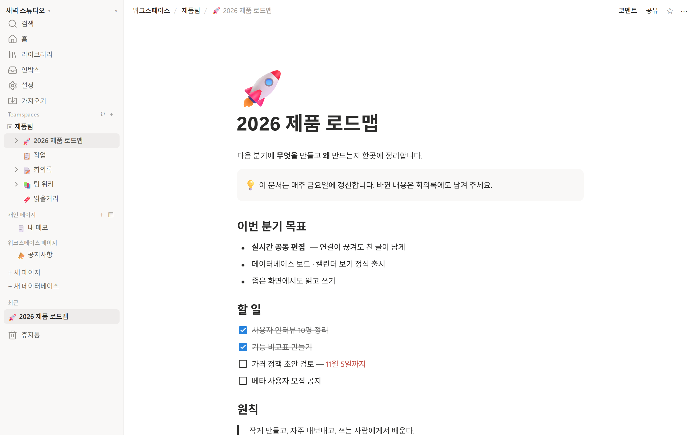
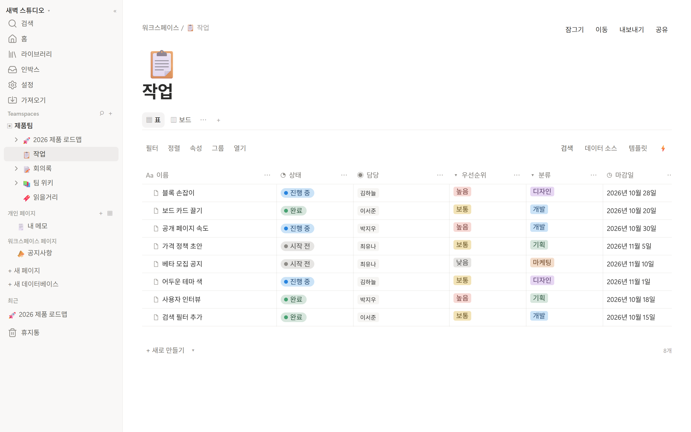
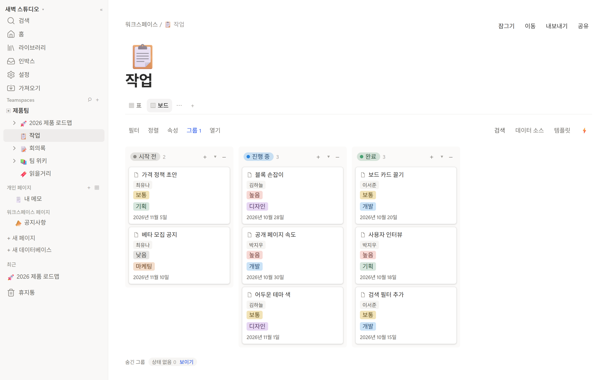
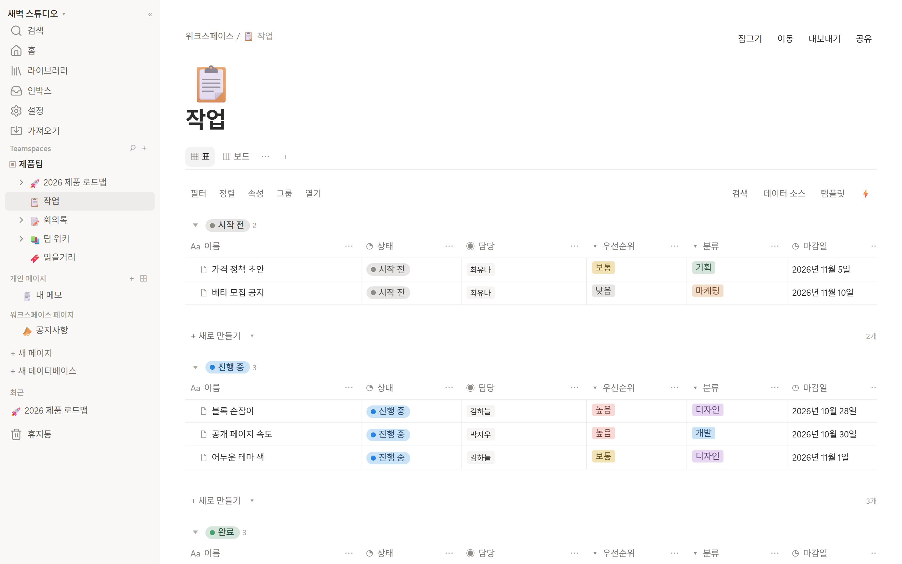
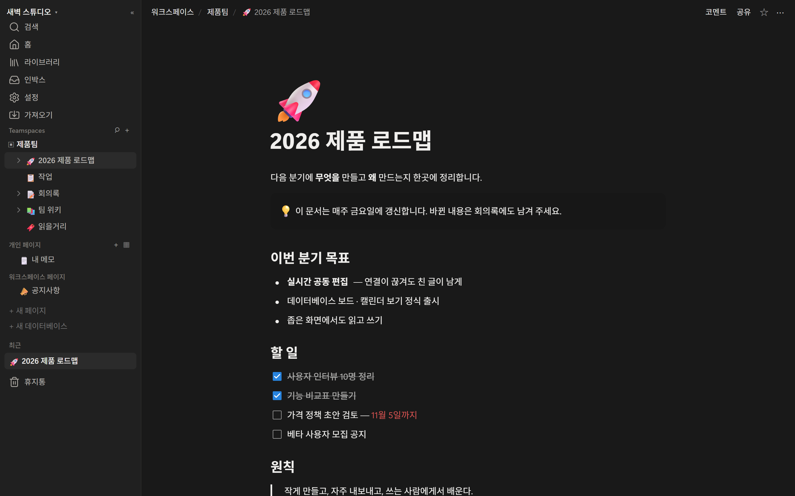

# notion-clone

[](https://github.com/pcw7/notion-clone/actions/workflows/ci.yml)

노션과 같은 기능을 하는 웹 애플리케이션입니다. **Next.js + TypeScript**로 만들고, 실시간 협업은 **Yjs(CRDT)**로 합니다.

노션 기능 278개를 조사해 스키마 정본을 정한 뒤 만들기 시작했습니다. MVP와 협업을 마쳤고, 지금은 제품화(Phase 2)의 남은 기능을 작은 트랙으로 이어 가고 있습니다. 지금까지 **약 195개**를 만들었습니다. 공개 API와 AI는 보류해 두었습니다.

<p align="center">
  
</p>

| 데이터베이스 — 표 | 데이터베이스 — 보드 |
|---|---|
|  |  |

<details>
<summary>더 보기 — 그룹으로 묶은 표 · 어두운 테마</summary>



</details>

<sub>사진 속 워크스페이스 · 사람 · 작업은 사진을 찍으려고 임시로 만든 예시입니다.</sub>

---

## 주요 기능

| 영역 | 무엇이 되나 |
|---|---|
| **편집** | 블록 22종(코드 · 수식 · 표 · 컬럼 · 파일 · 비디오 · 북마크 · 임베드 …) · `/` 메뉴 · 마크다운 단축키 · 서식 툴바 · 페이지 커버 · 버전 기록 |
| **협업** | 동시 편집 · 코멘트 · 멘션 · 인박스 · 접속자 표시 · 편집 이력 · 페이지 알림 받기 |
| **데이터베이스** | 표 · 목록 · 보드 · 갤러리 · 캘린더 · 차트 · 타임라인 · 폼 · 필터 · 정렬 · 그룹 · 수식 · 관계형 · 롤업 · 하위 항목 · 인라인 · 검증 속성 |
| **자동화** | 버튼 · DB automation(값 바꾸기 · 행 추가 · 웹훅 · 알림 보내기) · 리마인더 |
| **공유** | 페이지 단위 권한 · 팀 공간 · 게스트 · 웹 게시 · 공개 폼 · 신고 · 감사 로그 |
| **검색 · 파일** | 한국어 검색 · 검색 필터 · 커맨드 팔레트 · Markdown/CSV 가져오기 · 내보내기 |
| **계정** | 이메일 코드 로그인 · 비밀번호 · 2단계 인증 · 다중 계정 · 요금제 4종 · 계정 삭제 |
| **화면** | 노션에서 잰 값으로 맞춘 디자인 · 어두운 테마 · 좁은 화면 · 접근성 · 설치형 웹 앱 |

---

## 스택

| 영역 | 사용 |
|---|---|
| 앱 | Next.js 16 (App Router) · React 19 · TypeScript · Tailwind CSS v4 |
| 에디터 | ProseMirror (`@tiptap/pm`) · KaTeX · highlight.js |
| 협업 | Yjs · y-prosemirror · Hocuspocus(자체 호스팅) |
| 데이터 | PostgreSQL 16 + pg_bigm(한국어 검색) · Valkey |

무료 라이선스(MIT · BSD · Apache-2.0 · ISC · PostgreSQL License)만 쓰고, CI가 검사합니다.

---

## 시작하기

Node.js 24.7 이상이 필요합니다. Windows에서는 WSL2 Ubuntu 안의 Docker Engine을 씁니다([CLAUDE.md](CLAUDE.md)).

```bash
npm install
cp .env.example .env   # AUTH_SECRET 을 채운다

npm run db:up          # Postgres + Valkey
npm run db:migrate
npm run dev            # http://localhost:3000
npm run collab         # 협업 서버
npm run worker         # 스케줄러 — 리마인더 · 자동화 · 정리
```

로그인 코드는 메일 대신 `npm run dev` 터미널에 찍힙니다.

```bash
npm run check          # 타입 · 린트 · 라이선스 · 테스트
npm run e2e            # 실제 브라우저로 화면 검증(약 2,900개)
```

운영 명령(요금제 바꾸기 · 신고 처리 · 색인 다시 쓰기 등)은 [CLAUDE.md](CLAUDE.md)에 있습니다.

---

## 진행 상황

| Phase | 목표 | 상태 |
|---|---|---|
| 0 | MVP — 혼자 쓰는 노션 | ✅ |
| 1 | 협업 — 둘이 쓰는 노션 | ✅ |
| 2 | 제품화 — 팀이 쓰는 노션 | 진행 중 |
| 3 | 확장 · 엔터프라이즈 | |

**최근 추가** — 타임라인 뷰 · 차트(쌓기 · 값 하나) · 계정 삭제 · 알림 보내기 액션 · 임베드 블록 · 검증 속성

마이그레이션 134개 · 테스트 4,422개 · 브라우저 검증 2,866개 · PR 598개 머지. 조각별 진행은 [인수인계 문서](docs/HANDOFF.md)에 있습니다.

**아직 없는 것**
- 결제 연동과 실제 메일 발송 — 요금제는 운영자 명령으로, 로그인 코드는 터미널로
- 공개 API · AI(보류)
- 지도 · 대시보드 뷰
- 커스텀 도메인 · 오프라인으로 열기
- `LICENSE` 파일

---

## 설계 원칙

- **스키마는 raw SQL로 씁니다.** 불변식은 DB의 `CHECK` · 트리거가 막고, [검증 스크립트](scripts/verify-schema.mjs)가 실제로 거부되는지 던져 봅니다.
- **권한은 쿼리 안에서 거릅니다.** 볼 수 없는 것은 목록 · 검색 · 내보내기에 나오지 않습니다.
- **공개 화면은 따로 갑니다.** 웹 게시와 공개 폼은 앱의 조회 함수를 쓰지 않는 읽기 전용 경로입니다.
- **본문의 정본은 Y.Doc입니다.** 표의 블록 행은 그 투영입니다.
- **검사는 반사실로 확인합니다.** 방어 코드를 빼고 돌려 그 검사가 실제로 떨어지는지 봅니다.

---

## 문서

| 문서 | 내용 |
|---|---|
| [인수인계](docs/HANDOFF.md) | 진행 위치 · 다음 작업 · 내린 판결 · 알려진 한계 |
| [마스터 기능 명세서](docs/notion-feature-research.md) | 기능 인벤토리 · 로드맵 · 스택 선택 근거 |
| [정본 데이터 모델](docs/research/00-canonical-data-model.md) | 스키마의 유일한 정답지 |
| [도메인 상세](docs/research/) | 블록 에디터 · 데이터베이스 · 권한 · 협업 · 검색 등 |
| [CLAUDE.md](CLAUDE.md) | 절대 제약 · 코딩 규칙 · 개발 환경 · 운영 명령 |
