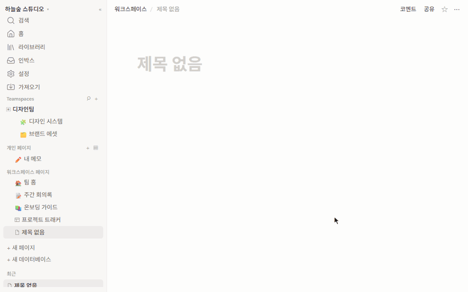
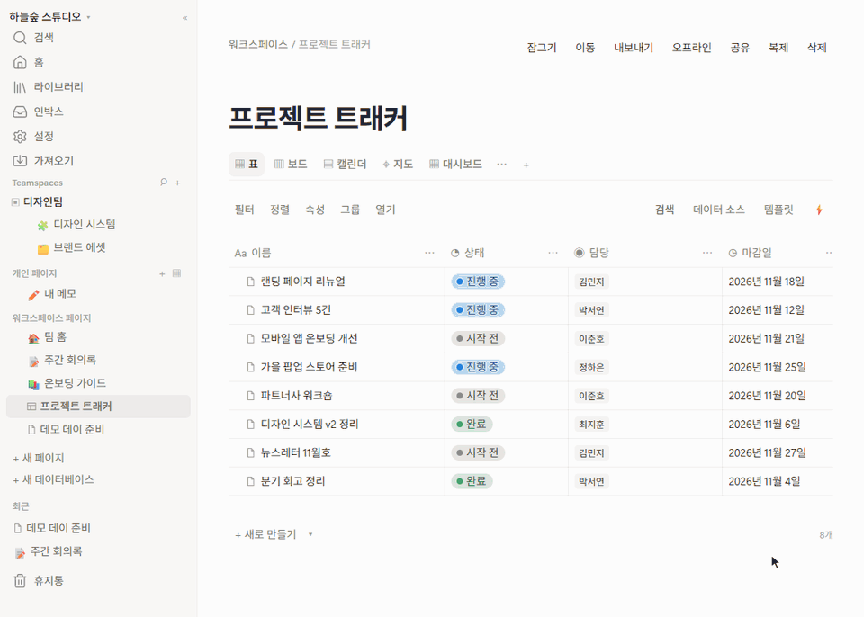
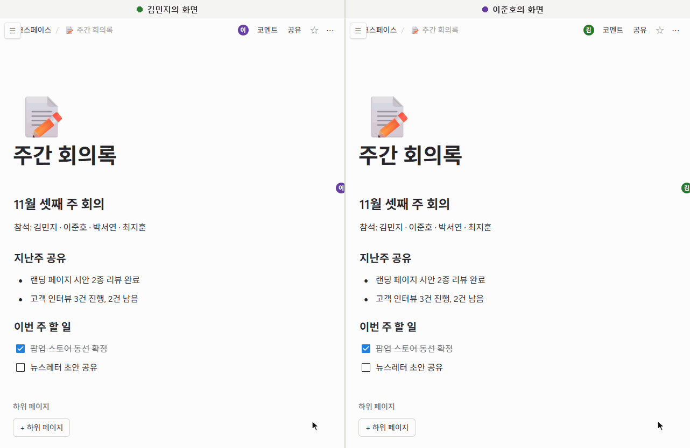

# notion-clone

[](https://github.com/pcw7/notion-clone/actions/workflows/ci.yml)

노션과 같은 기능을 하는 웹 애플리케이션입니다. **Next.js + TypeScript**로 만들고, 실시간 협업은 **Yjs(CRDT)**로 합니다.

**블록 편집**



**데이터베이스 뷰** — 표 · 보드 · 캘린더 · 지도 · 대시보드



**실시간 동시 편집**



<sub>영상 속 워크스페이스 · 사람 · 작업은 예시입니다.</sub>

---

## 주요 기능

| 영역 | 무엇이 되나 |
|---|---|
| **편집** | 블록 22종(코드 · 수식 · 표 · 컬럼 · 파일 · 비디오 · 임베드 …) · `/` 메뉴 · 마크다운 단축키 · 서식 툴바 · 제안 모드 · 버전 기록 |
| **협업** | 실시간 동시 편집 · 접속자 표시 · 코멘트 · 멘션 · 인박스 · 페이지 알림 |
| **데이터베이스** | 표 · 목록 · 보드 · 갤러리 · 캘린더 · 타임라인 · 차트 · 지도 · 대시보드 · 폼 · 모든 속성 타입 · 수식 · 관계형 · 롤업 |
| **자동화** | 버튼 · 데이터베이스 자동화(값 바꾸기 · 행 추가 · 웹훅 · 알림) · 리마인더 |
| **공유** | 페이지 단위 권한 · 팀 공간 · 게스트 · 웹 게시 · 공개 폼 |
| **검색 · 파일** | 한국어 검색 · 커맨드 팔레트 · Markdown/CSV 가져오기 · 내보내기 |
| **AI** | 빈 줄에서 묻기 · 고른 글 고치기 · 페이지 번역 · AI 블록(요약 · 할 일) · 워크스페이스를 근거로 답하는 채팅 · 모델 고르기 · 사용량 분석 — 기본은 꺼져 있고, 부르기 전에 한도를 확인해 넘으면 멈춘다 |
| **공개 API** | 노션 API(`2025-09-03`) 호환 `/v1` — 페이지 · 블록 · 데이터베이스 · 데이터 소스 질의 · 검색 · 코멘트 · 사용자 · 파일 올리기 · 개인 토큰 · 공식 SDK(`@notionhq/client`)로 동작 · 문서는 `/developers` |
| **오프라인** | 내려받은 페이지를 네트워크 없이 열고 고치기 · 다시 연결되면 자동 동기화 |
| **계정** | 이메일 코드 로그인 · 2단계 인증 · 다중 계정 · 요금제 · 어두운 테마 |

---

## 스택

| 영역 | 사용 |
|---|---|
| 앱 | Next.js 16 (App Router) · React 19 · TypeScript · Tailwind CSS v4 |
| 에디터 | ProseMirror (`@tiptap/pm`) · KaTeX · highlight.js |
| 협업 | Yjs · y-prosemirror · Hocuspocus(자체 호스팅) |
| 데이터 | PostgreSQL 16 + pg_bigm(한국어 검색) · Valkey |
| 지도 | Leaflet · OpenStreetMap |
| AI | OpenAI 호환 연결부 하나 — 기본 Groq, 주소 · 키 · 모델만 바꿔 OpenRouter · Gemini |

무료 라이선스(MIT · BSD · Apache-2.0 · ISC · PostgreSQL License)만 씁니다. AI 는 외부 서비스의 **무료 등급만** 씁니다(카드를 등록하지 않아 돈이 나갈 길이 없습니다).

---

## 시작하기

Node.js 24.7 이상이 필요합니다. Windows에서는 WSL2 Ubuntu 안의 Docker Engine을 씁니다([CLAUDE.md](CLAUDE.md)).

```bash
npm install
cp .env.example .env   # AUTH_SECRET 을 채운다

npm run db:up          # Postgres + Valkey
npm run db:migrate
npm run dev            # http://localhost:3000
npm run collab         # 협업 서버
npm run worker         # 스케줄러 — 리마인더 · 자동화 · 정리
```

로그인 코드는 메일 대신 `npm run dev` 터미널에 찍힙니다.

AI 를 쓰려면 `.env` 의 `AI_API_KEY` 에 무료 키(예: [Groq](https://console.groq.com/keys))를 넣고, 앱의 설정 → AI 에서 워크스페이스 소유자가 켭니다.
공개 API 는 설정 → 내 계정 → API 토큰에서 만든 `ntn_` 토큰으로 부릅니다.

```bash
npm run check          # 타입 · 린트 · 라이선스 · 테스트
npm run e2e            # 실제 브라우저로 화면 검증
```

---

## 문서

| 문서 | 내용 |
|---|---|
| [기능 명세서](docs/notion-feature-research.md) | 기능 인벤토리 · 로드맵 · 스택 선택 근거 |
| [데이터 모델](docs/research/00-canonical-data-model.md) | 스키마의 정본 |
| [도메인 상세](docs/research/) | 블록 에디터 · 데이터베이스 · 권한 · 협업 · 검색 등 |
